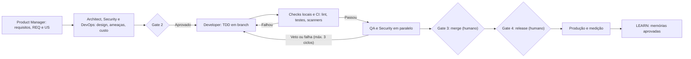

# Fluxo de Trabalho de Desenvolvimento (Feature Lifecycle)

Este documento descreve o ciclo de vida de uma demanda executada pelo time de agentes. Os estados e transições são impostos por `state.py` (ver `governance.md`).

## Etapas do Fluxo
1. **Definição**: o Product Manager cria o PRD, os REQ e as US e detalha os critérios de aceitação; o QA revisa a testabilidade (Níveis 2 e 3).
2. **Desenho Arquitetural**: o Arquiteto avalia o impacto e define o design (ADR só se a decisão for difícil de reverter); Security entrega o modelo de ameaças com requisitos; DevOps entrega custo e plano de observabilidade. Gate 2.
3. **Desenvolvimento**: o Desenvolvedor implementa o código e os testes automatizados em fatias, numa branch por tarefa, e roda tudo localmente antes do PR.
4. **Verificação**: depois do CI verde, QA (testes funcionais, E2E como código, desempenho) e Security (scanners e revisão de risco) trabalham em paralelo; o Arquiteto revisa a conformidade com as ADRs. Falhas e vetos voltam ao Desenvolvedor (no máximo 3 ciclos).
5. **Gate 3**: o humano aprova o merge.
6. **Gate 4 e entrega**: o humano aprova o release (rollback, observabilidade e, se houver dados pessoais, parecer jurídico); depois vêm produção, medição (`data-analytics`) e aprendizado (LEARN).

Nível 1 (ajuste) pula as etapas 1 e 2 formais: segue de INTAKE para BUILD, com Gate 3.
