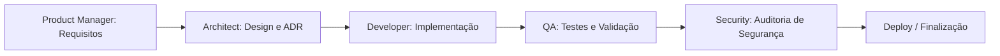

# Fluxo de Trabalho de Desenvolvimento (Feature Lifecycle)

Este documento descreve o ciclo de vida de uma demanda executada pelo time de agentes:

## Etapas do Fluxo
1. **Definição**: Product Manager cria o PRD e detalha os critérios de aceitação.
2. **Desenho Arquitetural**: O Arquiteto avalia o impacto e define o design da solução.
3. **Desenvolvimento**: O Desenvolvedor implementa o código e os testes automatizados.
4. **Garantia de Qualidade**: O QA executa testes de validação funcional e regressão.
5. **Auditoria de Segurança**: O Especialista de Segurança revisa dependências, vulnerabilidades e exposição de dados.
6. **Entrega**: A feature é aprovada para merge e publicação.
