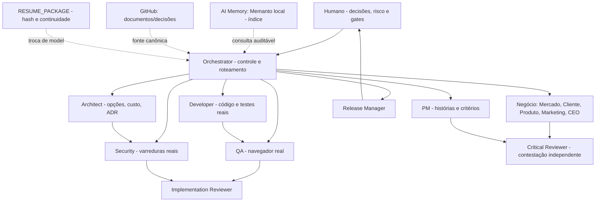

# Arquitetura organizacional V5 — diretriz executável

## 1. Objetivo e princípio de projeto

O produto deste piloto é a **organização de agentes confiável**. Não construir aplicação apenas para parecer que a arquitetura funciona. A primeira validação é a máquina de governança, seguida de uma funcionalidade mínima real com UI, testes e segurança; depois pesquisa de mercado/produto/marketing. Padrão profissional significa **provas repetíveis**, não volume de prompts.

Critérios irrenunciáveis: separação de duties; papéis sêniores especializados; outputs versionados; entradas aprovadas; revisão independente; fail-closed; trilha de evidência; limites de custo, privilégios e ciclos; autoridade humana; continuidade de contexto cross-model; menor complexidade técnica viável.

## 2. Organização



As 19 responsabilidades estão em `.agents/agents/*.md` (novos perfis somados àqueles preexistentes). Agentes consultores (CEO, Research, Compliance) não implementam código; engenharia não toma decisão estratégica final. O roteamento e autoria são logicamente isolados; isolamento de execução efetivo depende da IDE, runner e permissões MCP e deve ser auditado no ambiente.

## 3. Contratos e estados

Todo documento de handoff tem:

```json
{
  "id":"ART-EXEMPLO-001", "run_id":"RUN-EXEMPLO", "version":"5.0",
  "kind":"intake", "role":"orchestrator", "status":"submitted",
  "summary":"Objetivo observado e contexto", "input_ids":[],
  "evidence_refs":["docs/validacao.md"],
  "sections":{"goal":"Definir meta", "scope":"Escopo explícito",
    "constraints":"Sem deploy", "risk_level":"Nível 2", "definition_of_success":"Evidência funcional"}
}
```

Validação estrutural por `org_v5/contracts.py`. Submissão gera SHA-256 da representação canônica e exige `input_ids` já aceitos. `review` registra decisão de outro papel; quem produz não aprova. `advance` exige estado sequencial e tipos aceitos. PASS de QA/Security exige log real não vazio, hash do log e arquivos de evidência existentes; **isso reduz falsos positivos, mas não comprova por si só que houve interação humana genuína**. Revisor confere traces e ambiente, CI executa E2E quando houver aplicação.

Fluxo linear inicial: `INTAKE → DISCOVERY → PLANNING → DESIGN → BUILD → VERIFY → RELEASE → LEARN → CLOSED`. Gate humano ao entrar BUILD, RELEASE ou CLOSED; MEMORY_WRITE também exige aprovação. Nível 1 a 3 determina a profundidade documental; no piloto o motor mantém exigências mínimas para todos os níveis e não oferece atalhos sem cobertura. Estados excepcionais: `ESCALATED`, parada `.agents/state/STOP`. Ao terceiro REWORK na mesma ligação de papéis o caso escala.

## 4. Matriz de entregas

| Trilha | Entrada | Owner / saída | Revisão independente | Gate |
|---|---|---|---|---|
| Intenção | demanda humana | Orchestrator / intake | Critical Reviewer ou PM | DISCOVERY |
| Descoberta | intake aceito, fontes reais | Market / market-research | Critical Reviewer | PLANNING |
| Estratégia | estudo de mercado e cliente | Product Strategist / strategy | Critical Reviewer | decisão humana caso alto impacto |
| Produto | pesquisa e decisão | Product Manager / prd, US/AC rastreáveis | QA / Architect | DESIGN |
| Arquitetura | PRD aprovado | Architect / architecture | Security / Implementation | BUILD após aprovação |
| Desenvolvimento | PRD + arquitetura | Developer / build e logs de testes | QA / Implementation | VERIFY |
| Verificação | build real | QA + Security / relatórios e logs reais | Implementation Reviewer | RELEASE com aprovação |
| Operação | QA/Security + rollback | Release Manager / release | Implementation | produção somente com aprovação explícita adicional |
| Memória | artefatos aceitos, decisões | Memory Curator / proposta | Critical Reviewer + humano | MEMORY_WRITE |

Uma lista de nomes de papéis não prova governança: verifique a matriz de permissões e a execução. A regra `REQUIRED` em `control.py` é mínima e **não** substitui a política executiva de gate e a exigência adicional de compliance quando houver dados regulados.

## 5. QA e segurança

Para frontend: Playwright ou navegador real, teste de botões, inputs, navegação, validações, requests, mensagens, erros de console, screenshot/trace e AC; mocks são admitidos só em testes isolados explicitamente rotulados. Para backend sem UI: integração real em processo/HTTP, banco de teste e comportamento observado; o campo `browser-interactive` é aplicável somente a QA de UI. O piloto inicialmente endurece o contrato de `qa-report` para UI; ajuste tipado para backend em futura ADR revisada, sem fingir cliques inexistentes.

Segurança: SAST/scan de dependências/secret scanning reais conforme stack; threat model e abuse cases; registrar comandos, versões, findings, falso positivo e limitações; scanners não substituem revisão manual. Nunca executar scanner de terceiros não aprovado ou fazer pentest fora do ambiente autorizado. Todo FAIL/BLOCKED interrompe a promoção.

## 6. AI Memory — arquitetura obrigatória

**Três camadas:**

- **L0 Git canônico:** DEC, PRD, ADR, EVID, pareceres, código e policy; versionamento, PR e histórico. Agentes jamais promovem uma recordação à verdade sem confirmar documentos/fonte.
- **L1 RESUME_PACKAGE:** exportável por run com IDs, hashes, estados, pendências, aprovações e últimos eventos. Transporta contexto entre Gemini, Claude e Ollama; a janela de contexto é descartável, o pacote é reaplicável. Dados sensíveis ficam de fora.
- **L2 Memanto on-prem:** índice temporal e semântico, armazena apenas fatos/decisões/lições sintetizados com DEC/EVID, confiança, proveniência, TTL, aprovação humana e recibo; somente via wrapper auditável. Sem backend válido: MEMORY_OFFLINE, sem conteúdo fictício.

Recuperação obrigatória antes de pesquisa relevante, arquitetura ou planejamento. Curadoria na conclusão da run; orçamento máximo de itens. As permissões e residência de dados precisam ser verificadas. Os planos Claude Pro e Gemini não implicam automaticamente API de orquestração; veja roteamento abaixo.

## 7. Roteamento de modelos, custo e skills

**Fase piloto:** todos `model: inherit` para evitar aliases inválidos; seleção manual explícita na IDE conforme modelos realmente disponíveis. Benchmark local deve medir qualidade por papel (fonte, aderência a schemas, número de retries, latência/custo, segurança) com caso fixo, sem favorecimento de fornecedor. Proposta inicial:

| Papel | Perfil de modelo desejado | Observação |
|---|---|---|
| Orchestrator | rápido, forte em ferramentas e contratos | priorize custo/latência, sem gerar análise especialista |
| Research / CEO / Critical / Architect | raciocínio aprofundado, contexto longo, citações | comparação Gemini vs Claude baseada em evals reais |
| Developer / Security / QA | bom coding + tools, forte em depuração | comparar autonomia, correções, não apenas qualidade do texto |
| Analytics | precisão tabular e cálculos reproduzíveis | cálculo real em scripts, não LLM puro |
| Memory Curator | baixo custo, extração estruturada | revisão humana para gravação |
| Ollama | tarefas locais e dados classificados após benchmark | isolamento real de rede, logs e MCP deve ser auditado |

Skills V5: `org-v5-run`, `org-v5-memory`, `org-v5-browser-qa`, `org-v5-research`. Não adicionar LangGraph e OpenAI Agents SDK simultaneamente, fila, vector DB, Kafka ou serviço central antes que os controles locais provem insuficiência.

## 8. Matriz de autonomia

- **A0 automático:** leitura de documentos autorizados, elaboração de rascunhos, validação de contrato, execução dos testes em sandbox, relatório de evidência.
- **A1 revisado por agente independente:** handoff, revisão de artefato, pesquisa, planejamento e estratégia preliminar; sem autoaprovação.
- **A2 humano:** estratégia com risco material, alteração de arquitetura global, contratação e custos, acesso a dados sensíveis, permissões Git/MCP, memória persistente e merge.
- **A3 humano explícito:** apagar dados, migrações irreversíveis, secrets, publicação em produção e qualquer ação com impacto externo de clientes.

A CLI é uma camada de workflow, **não** de autenticação; políticas de branch protection, CODEOWNERS, permissões MCP, approvals reais no GitHub e políticas do Antigravity devem fornecer enforcement da autorização.

## 9. Termos de sucesso do piloto

- 100% dos testes de governança passaram (proibido placeholder).
- Um fluxo completo de UI real: PRD com Given/When/Then, arquitetura simples, build, unitários, E2E no navegador, security scan, correção reprodutível, revisão independente e aprovação Git registrada.
- Falso PASS gerado deliberadamente deve ser recusado; alteração de SHA deve bloquear; self-approval e bypass de estado devem falhar.
- Memanto: status local, armazenamento com recibo e leitura após troca de modelo; medir recall útil e bloqueio se backend offline.
- Reexecutar casos `evals/cases/` legados com scripts V5, registrar taxa de rejeição, falsos positivos, tokens, duração e custo.
- Um caso de negócio (pesquisa real com benchmark e fontes) precisa sobreviver ao Critical Reviewer e produzir decisão com prós/contras e riscos.
