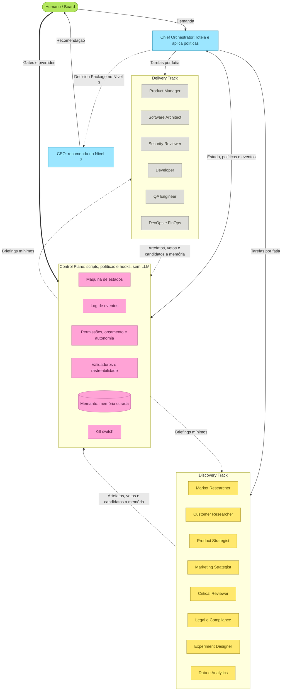
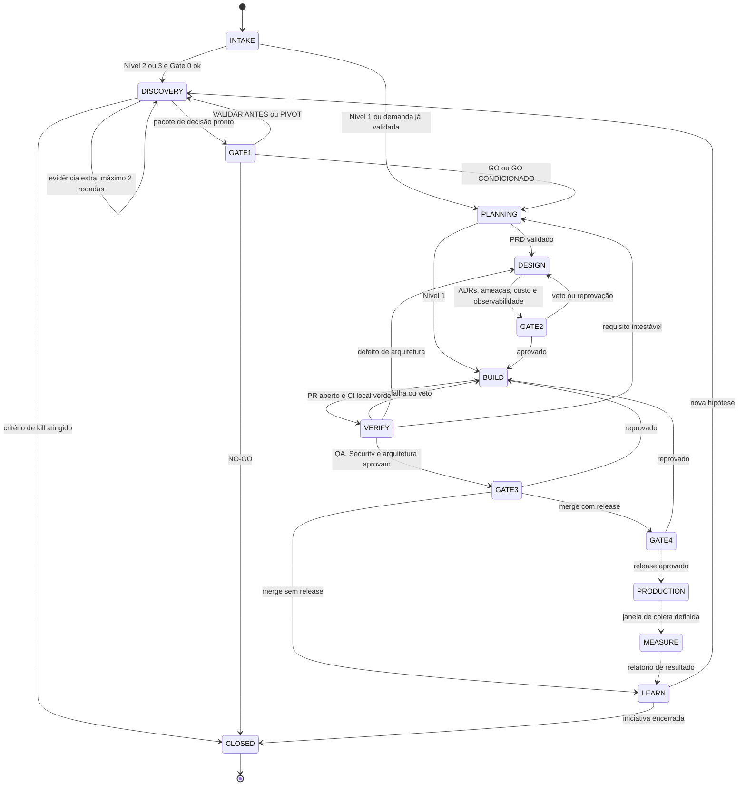

# Arquitetura da Organização
**Versão V4, 2026-10-04**

## Visão Geral V4

Nesta versão, a organização de agentes opera estruturada em **Níveis de Execução**, **Gates de Decisão**, e **Control Plane** isolado do fluxo heurístico.

**Níveis (1 a 3):**
- **Nível 1:** Ajustes e pequenos fixes. Sem Discovery profundo, vai direto ao planejamento e Build.
- **Nível 2:** Iniciativas e features normais. Envolve Discovery formal, planejamento, design, build e Gates 0 a 4. 
- **Nível 3:** Alta complexidade/Risco. Exige o CEO no loop recomendando, com evidência primária (E2) e opções.

**Gates (0 a 4):**
- Gate 0: Automático de triagem.
- Gate 1: Humano decide (GO, GO CONDICIONADO, VALIDAR ANTES, PIVOT, NO-GO) com base no Decision Package.
- Gate 2: Validação de requisitos, ADRs, ameaças, custo (automático ou humano).
- Gate 3: Merge (Humano).
- Gate 4: Release (Humano).

**Autonomia e Control Plane:**
Autonomia varia de A0 (Tudo Humano) a A3 (Agente age sem perguntar). O **Control Plane** garante a imutabilidade do estado via scripts Python (`state.py`, `events.py`, `budget.py`, `validate.py`) e Hooks, bloqueando ferramentas em estados proibidos. Política de memória rigorosa filtra a "sujeira", e consolida dados valiosos via `memory_ops.py` (`RISK`, `INCIDENT`, `CONSTRAINT`).

**Os 16 Agentes:**
O roster agora é padronizado e inclui, além dos engenheiros e do Orchestrator: CEO, Product Strategist, Market Researcher, Customer Researcher, Marketing Strategist, Critical Reviewer, Legal Compliance, Experiment Designer e Data Analytics.

## Diagramas da Arquitetura V4

### Visão Geral

### Máquina de Estados

Observação para o documento: de qualquer estado a run pode ir para ESCALATED (motivo registrado, por vetos sem solução em 3 ciclos, orçamento esgotado ou comportamento anômalo) ou PAUSED (humano); a saída desses dois estados é sempre decisão humana.

## Elenco e Ferramentas Principais
*Nota: Ferramentas estão padronizadas usando a infraestrutura nativa do Antigravity ou CLI (e.g. `search_web`, `read_url_content`, `Semgrep`, `gitleaks`, `Trivy`, etc.).*

| Agente | Responsabilidades | Ferramentas Atribuídas |
| :--- | :--- | :--- |
| **orchestrator** | Gestão de fluxo, contratos, roteamento, orçamentos. | Nenhuma de pesquisa (coordena via scripts) |
| **ceo** | Recomendações estratégicas e desempates (Nível 3). | `search_web`, arquivos e scripts locais |
| **market-researcher** | Inteligência de mercado e concorrentes. | `search_web`, `read_url_content`, etc. |
| **customer-researcher**| VoC e pesquisa primária com clientes. | `search_web`, `read_url_content` |
| **product-strategist** | JTBD, ICP, pricing, proposta de valor. | `search_web`, leitura de arquivos |
| **marketing-strategist**| Go-to-Market, unit economics. | `search_web`, leitura de arquivos |
| **critical-reviewer** | Red Team, premissas assassinas e pre-mortem. | `search_web`, arquivos |
| **legal-compliance** | Risco legal, tradução de normas para engenharia. | `search_web`, arquivos |
| **experiment-designer**| Plano de validação, métodos (fake doors, etc). | `search_web`, arquivos |
| **data-analytics** | Métricas de sucesso, tracking plan, mensuração. | `search_web`, arquivos (só leitura) |
| **product-manager** | Requisitos, histórias de usuário, PRD, backlog. | Nenhuma de pesquisa externa |
| **architect** | Modelagem (C4, Mermaid), ADRs, desenho técnico. | Nenhuma (usa código local) |
| **developer** | Escrita e testes de código, CI local. | Git, compilers, linting |
| **security-reviewer** | Ameaças (Semgrep, gitleaks, Trivy), CI de risco. | Scanners, leitura de código |
| **qa** | Planejamento de testes, E2E (Playwright), CWV. | Chrome DevTools MCP (ou CLI) |
| **devops-finops** | FinOps, releases, observabilidade, CI/CD, custos. | CLI e scripts de ambiente |
